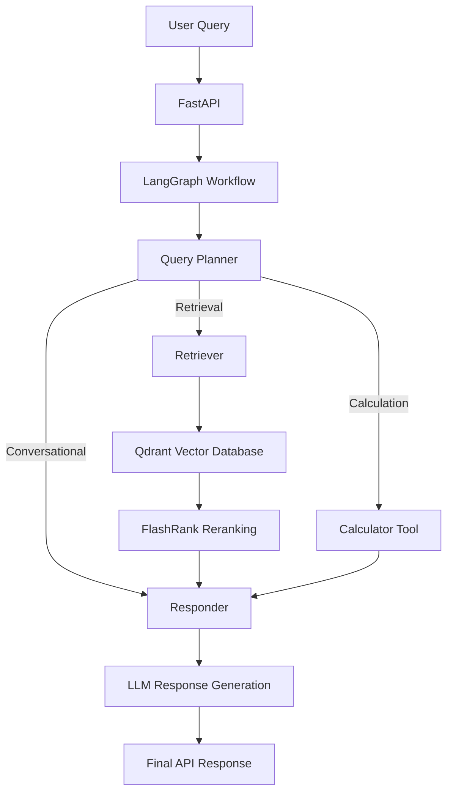

# Enterprise Agentic RAG API

An enterprise-oriented **Agentic Retrieval-Augmented Generation (RAG) application** built using Python, FastAPI, LangGraph, Groq, and Qdrant.

The application uses an intelligent query-routing workflow to process user requests through conversational response generation, document retrieval, or calculator tool execution. It combines LLM-based reasoning, semantic search, and modular agent workflows to deliver context-aware responses.

## 🚀 Key Features

- **Agentic Workflow:** Implemented a LangGraph-based workflow to intelligently classify and route user queries.
- **Retrieval-Augmented Generation (RAG):** Retrieves relevant document chunks from Qdrant to generate context-aware responses.
- **Vector Search:** Uses embedding-based semantic search for retrieving relevant information from knowledge sources.
- **Document Reranking:** Integrated FlashRank to improve the relevance of retrieved document passages.
- **Calculator Tool:** Implemented a calculator tool to process mathematical queries through the agent workflow.
- **LLM Integration:** Uses Groq-hosted LLMs for query planning and response generation.
- **Conversation State Management:** Uses LangGraph state management to maintain workflow context and intermediate results.
- **API Development:** Built REST API functionality using FastAPI.
- **AI Guardrails:** Integrated NeMo Guardrails for controlled AI interactions.
- **Observability:** Integrated Logfire for application monitoring and debugging.

## 🏗️ Architecture



## 🛠️ Technology Stack

| Category | Technologies |
|---|---|
| Programming Language | Python |
| Backend Framework | FastAPI |
| Agent Orchestration | LangGraph |
| LLM Provider | Groq |
| Vector Database | Qdrant |
| Reranking | FlashRank |
| AI Guardrails | NeMo Guardrails |
| Observability | Logfire |
| Embeddings | Sentence Transformers |
| API Server | Uvicorn |

## 📂 Project Structure

```text
enterprise-agentic-rag/
│
├── app/
│   ├── agents/
│   │   ├── nodes/
│   │   │   ├── planner.py
│   │   │   ├── responder.py
│   │   │   └── retriever.py
│   │   │
│   │   ├── graph.py
│   │   └── state.py
│   │
│   ├── tools/
│   │   └── calculator.py
│   │
│   ├── gateway/
│   │   └── client.py
│   │
│   ├── config.py
│   └── main.py
│
├── .env.example
├── requirements.txt
└── README.md
```

*Note: The structure above represents the project's main modules. Adjust it if your repository contains additional files or different filenames.*

## ⚙️ Installation and Setup

### 1. Clone the Repository

```bash
git clone <YOUR_GITHUB_REPOSITORY_URL>
cd enterprise-agentic-rag
```

### 2. Create a Virtual Environment

**Windows:**

```bash
python -m venv .venv
.venv\Scripts\activate
```

**Linux / macOS:**

```bash
python3 -m venv .venv
source .venv/bin/activate
```

### 3. Install Dependencies

```bash
pip install -r requirements.txt
```

### 4. Configure Environment Variables

Create a `.env` file using `.env.example` as a template.

Configure the required API keys and service credentials according to your application configuration.

Example:

```env
GROQ_API_KEY=your_groq_api_key
QDRANT_URL=your_qdrant_url
QDRANT_API_KEY=your_qdrant_api_key
```

Add the model and collection settings required by your implementation.

**Important:** Never upload your `.env` file or expose API keys on GitHub.

### 5. Run the Application

```bash
uvicorn app.main:app --reload
```

The API will be available at:

```text
http://127.0.0.1:8000
```

Access interactive API documentation:

```text
http://127.0.0.1:8000/docs
```

*Ensure the module path matches your actual FastAPI application entry point.*

## 🔄 Application Workflow

1. The user submits a query through the FastAPI interface.
2. LangGraph initializes the workflow and manages the application state.
3. The planner analyzes the query and selects the appropriate execution path.
4. Depending on the query, the workflow executes:
   - Conversational response generation.
   - Document retrieval using Qdrant.
   - Mathematical computation using the calculator tool.
5. Retrieved documents or tool results are passed to the response-generation stage when applicable.
6. The LLM generates the final response.
7. FastAPI returns the result to the client.

## 📊 Evaluation and Performance Metrics

The application can be evaluated using the following metrics:

| Metric | Purpose |
|---|---|
| Retrieval Precision@K | Measures relevance of retrieved documents |
| Recall@K | Measures retrieval coverage |
| Answer Accuracy | Measures correctness against a labelled test set |
| Groundedness | Measures whether responses are supported by retrieved context |
| P50 Latency | Measures median response time |
| P95 Latency | Measures high-percentile response time |
| Token Usage | Tracks LLM consumption |
| Tool Routing Accuracy | Measures correct tool selection |

Performance metrics should be populated after running a repeatable evaluation. No unverified accuracy or latency figures are claimed.

## 🔐 Security Considerations

- Store credentials securely using environment variables.
- Validate user inputs before processing.
- Avoid exposing sensitive information in application logs.
- Configure appropriate API authentication and rate limiting before public deployment.
- Test guardrail behaviour against potentially unsafe inputs.

## 🔮 Future Enhancements

- Integrate web search capabilities.
- Add SQL query execution tools.
- Implement MCP-based tool connectivity.
- Extend conversational memory and session management.
- Develop automated evaluation pipelines.
- Track retrieval accuracy, response latency, and token costs.
- Containerize the application using Docker.
- Explore Kubernetes-based deployment.

## 👨‍💻 Author

**Uday Kiran Dende**

Aspiring AI Engineer | Agentic AI | RAG | LLM Applications

- LinkedIn: udaykirandende (https://www.linkedin.com/in/udaykirandende))

---

⭐ If you find this project interesting, consider giving the repository a star.
